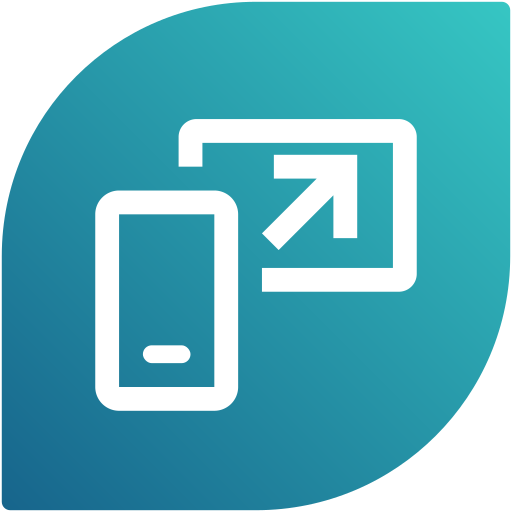

# Sailconnect 应用图标



以“手机屏幕发送到接收端”为视觉主题。前景手机与后景横向屏幕通过向右上的箭头建立关系，
白色几何符号搭配蓝绿渐变，适合 Sailfish OS 应用列表。

底形采用官方模板中左上、右下为圆弧的圆方组合轮廓。设计画布为 86×86，底形边界为
0.3 至 85.7，沿用官方模板的 0.3 像素边距。符号使用约 4 像素粗度，箭头与屏幕框留有间隙。

- 矢量源文件：[../rpm/harbour-sailconnect.svg](../rpm/harbour-sailconnect.svg)
- 透明背景预览：[harbour-sailconnect.png](harbour-sailconnect.png)，512×512。
- 应用列表 PNG：`../rpm/icons/` 下的 86×86、108×108、128×128、172×172。
- 官方规范与模板：<https://sailfishos.org/design/icons/>
- 尺寸与安装路径：<https://sailfishos.org/develop/docs/silica/sailfish-application-scalability.html/>

修改 SVG 后重新导出：

```sh
python3 -m pip install CairoSVG
python3 scripts/export-icons.py
```

PNG 已随源代码提供；常规 RPM 构建无需安装图标导出依赖。包内图标沿用
`harbour-sailconnect` 名称，并安装至 `/usr/share/icons/hicolor/<size>x<size>/apps/`。

底形依据 Jolla 的 Sailfish Apps Icon Template 绘制，该模板以 CC BY 3.0 发布，
模板说明豁免署名要求。手机、屏幕与箭头为本项目绘制。

## 活动封面

封面使用透明的手机、接收屏幕和投射箭头线稿，与启动图标共用符号，但去掉彩色底形。
图像通过 Silica `Icon` 随系统氛围着色；等待连接时降低透明度，连接期间提高对比度。
封面同时显示简短状态和投屏尺寸，只在连接期间显示停止动作。

- 可编辑源图：[../app/images/cover-sailconnect.svg](../app/images/cover-sailconnect.svg)
- 透明图像：[../app/images/cover-sailconnect.png](../app/images/cover-sailconnect.png)，1080×780。
- 界面：[../app/cover/CoverPage.qml](../app/cover/CoverPage.qml)
- 手机原生渲染的隔离预览：[等待连接](cover-idle.png)、[正在投屏](cover-streaming.png)。
  预览使用深色背景便于查看；应用中的封面保持透明，背景来自系统氛围。

修改源图后运行 `python3 scripts/export-cover.py`。构建直接使用提供的 PNG，无需额外图像库。

## 连接向导与关于页面

连接向导使用五步进度、原生触摸提示和固定的上一步/继续操作栏；横屏收起大图示，
长说明在操作栏上方滚动。主页下拉菜单可以随时重新打开。

关于页面采用居中的图标、名称、版本与作者，再列出接收端、参考项目和基础组件。
项目行可点击，名称、作者与说明分层显示，横屏变为两列。

手机原生 Qt/Silica 的隔离渲染预览：

- [连接向导首步](guide-1-pairing-zh_CN.png)
- [投屏完成](guide-5-streaming-zh_CN.png)
- [横屏向导](guide-5-landscape-zh_CN.png)
- [关于页面](about-top-zh_CN.png)
- [接收端和参考项目](about-projects-zh_CN.png)

这些预览使用模拟状态和深色背景，实际页面颜色随系统氛围变化。
